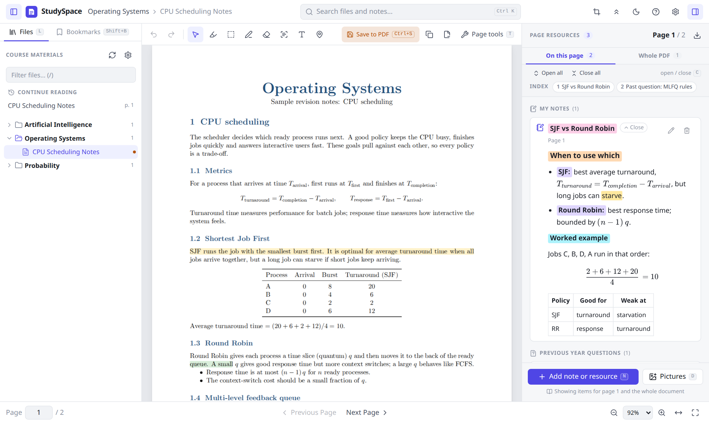
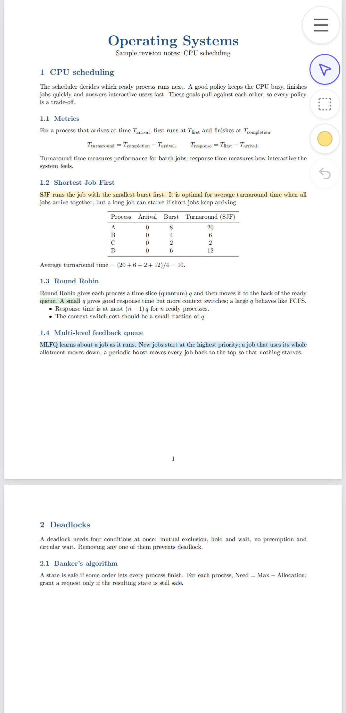

# StudySpace

**A local-first study workspace for PDFs: your library on the left, the PDF in the middle, and the notes for the page you're reading on the right.** It runs on your own computer, reads your files where they already are, and works offline, with no account, no upload and no API key.

## Why I built it

While studying I kept switching between a PDF reader, a notes app and a folder full of slides, and my notes never stayed with the page they were about. Finding what I had written about one page meant searching three places.

So I built a reader where every note belongs to a page. When I come back to a page, everything I wrote about it is already beside it: my own notes, summaries, past questions, explanations and links. Over time it grew into the one tool I study in: highlighting, page editing, OCR, bookmarks, and a phone view for reading away from the desk.

## Features

- **Library:** it finds the PDFs, slides (`.pptx`, `.ppt`), HTML pages and Markdown files in my folders, groups them by folder, and remembers where I stopped reading. I can rename, delete and hide files, and search everything with `Ctrl+K`.
- **Notes that follow the page:** each note belongs to a page, a page range or the whole file, and the notes panel always shows the ones for the page in view. Notes are Markdown with LaTeX math, tables and pictures. I keep five kinds: my own notes, summaries, previous-year questions, AI explanations and links.
- **Marking up the PDF:** text and area highlights, a pen, an eraser, text boxes and note markers. *Save to PDF* writes them into the file as standard annotations, so other PDF readers show them too.
- **Page tools:** insert, delete, replace, rotate and move pages, or extract, split and merge into new PDFs. The notes stay on the right pages through every edit.
- **Bookmarks:** the PDF's own outline is read in; I can edit it and save it back into the file.
- **Get text and OCR:** pages, a bookmark's section or a drawn region become Markdown or plain text, with my highlights and notes included if I want. Scanned pages can be OCRed.
- **Reading tools:** two PDFs side by side, back and forward through jumps, pages saved as pictures, a screenshot of any part of the window.
- **Undo everything:** `Ctrl+Z` covers notes, highlights, bookmarks and even page edits. An edited PDF keeps its previous versions as a backup.
- **Keyboard first:** every feature has a key, shown beside it. `?` in the app lists them all.
- **Phone:** it opens over Wi-Fi or Tailscale with a password, and installs as a full-screen app. Pages fit the screen, two fingers zoom, and turning the phone sideways fills the screen with one slide ([phone setup](docs/PHONE_SETUP.md)).

Every feature, step by step: **[docs/USER_GUIDE.md](docs/USER_GUIDE.md)**.

## Set it up on your PC

It takes about five minutes. You need **Node.js 24 or newer** and **Git**; nothing else is required.

### 1. Install Node.js and Git

| System | Commands |
| --- | --- |
| **Windows 10/11** (PowerShell) | `winget install -e --id OpenJS.NodeJS.LTS`<br>`winget install -e --id Git.Git`<br>Then **close and reopen** the terminal. |
| **macOS** | Install [Homebrew](https://brew.sh), then `brew install node git` |
| **Ubuntu / Debian** | `sudo apt install git curl`<br>`curl -o- https://raw.githubusercontent.com/nvm-sh/nvm/v0.40.3/install.sh \| bash`<br>Reopen the terminal, then `nvm install 24` |
| **Fedora / Arch** | `sudo dnf install git nodejs` or `sudo pacman -S git nodejs npm` (if `node -v` says less than 24, use nvm as on Ubuntu) |

Or download them from [nodejs.org](https://nodejs.org) and [git-scm.com](https://git-scm.com). Check with `node -v` (v24 or newer) and `git --version`.

### 2. Get the code and start it

```bash
git clone https://github.com/Irham-Dipra/studyspace.git
cd studyspace
npm install
npm run check
npm run dev
```

- `npm install` downloads the packages (a minute or two; no compiler needed).
- `npm run check` looks at your computer. Each line is `[ok]`, `[--]` (optional and missing, which is fine) or `[!!]` (required and missing: fix it and run the check again).
- `npm run dev` starts StudySpace and prints its address after **Local:**. Leave that terminal open while you study; `Ctrl+C` stops it.

Without Git, use **Code → Download ZIP** on GitHub, unzip it, and open a terminal in that folder.

### 3. Add your PDFs

Open the address `npm run dev` printed (normally `http://localhost:5173`; if that port is busy it picks the next free one), click **⚙ Settings → Library folders**, and add the folder that holds your PDFs (browse to it, or type its path, such as `D:\Courses` or `/home/you/Courses`). Your files show up on the left. Click one and start reading.

Next time, open a terminal in the `studyspace` folder and run `npm run dev`.

### Optional extras

- **Slides and OCR:** LibreOffice opens `.pptx` files, and OCRmyPDF with Tesseract reads scanned pages. Install commands for each system are in [REQUIREMENTS.md](REQUIREMENTS.md). You can add them at any time.
- **A settings file:** copy `.env.example` to `.env` to set your PDF folder, the ports, a phone password or the OCR language.
- **Updating:** `git pull`, then `npm install`.

### Moving your notes to another PC

The notes are not in this repository. They live in StudySpace's data folder (see [Where your data lives](#where-your-data-lives)). To move them:

1. Stop StudySpace on both computers.
2. Copy the old computer's whole data folder to the new computer's data folder. The place depends on the system (see the table), so a folder from Linux goes to `%LOCALAPPDATA%\StudySpace` on Windows.
3. Copy your PDFs to the new computer, start StudySpace and add their folder in Settings.

StudySpace recognises a file by its content, not its path, so notes, highlights and bookmarks find their PDFs again even in a different folder. Keep the PDFs unchanged on the way.

## What it looks like

**On a computer:** the library, the PDF and the notes for the current page.



**On a phone:** the page gets the whole screen. The ☰ button opens everything else, and the small buttons under it switch tools without opening the menu.



### The tools

| Tool | Key | What it does |
| --- | --- | --- |
| Select | `V` | Select text to copy it, highlight it or quote it into a note. Click a highlight to recolour or delete it. |
| Highlight | `H` | Every selection becomes a highlight in the current colour. |
| Highlight area | `A` | Drag a box over a figure, a table or scanned text. |
| Pen | `P` | Draw freehand, in three widths. |
| Eraser | `E` | Click or drag over highlights and drawings to remove them. |
| Get text from a region | `O` | Drag a box; the text inside it is read out (OCR for scanned pages). |
| Text box | `Y` | Click on the page and type. |
| Note marker | `K` | Put a pin on the page that opens a note. |
| Colours | `1`–`5` | The colour for the tool that is on. |
| Undo / redo | `Ctrl+Z` / `Ctrl+Shift+Z` | Every change, including page edits. |
| Save to PDF | `Ctrl+S` | Writes highlights, drawings and bookmarks into the PDF file itself. |
| Page tools | `T` | Insert, delete, replace, turn and move pages; extract, split and merge; get text and OCR; save pages as pictures. |

The PDFs in the screenshots are small samples made for this page.

## Commands

| Command | What it does |
| --- | --- |
| `npm run dev` | Development: the server on port 4317 (restarts on code changes) and the web page (hot reload) on the address it prints: port 5173, or the next free one. |
| `npm start` | Builds the web page, then serves everything from one process on **http://localhost:4317**. Use this for daily use or for a phone. |
| `npm run check` | Checks Node, the npm packages, the optional tools and the ports. |
| `npm test` | Server tests (Vitest). |
| `npm run typecheck` | TypeScript checks for the server and the web page. |
| `npm run build` | Builds `web/dist` and `server/dist` without starting anything. |

## Configuration

Everything is optional. Settings come from `.env` in the project folder (copy [.env.example](.env.example)), and real environment variables override it. Most things, such as your library folders and what to hide, are set in the app under **⚙ Settings** instead.

| Variable | Default | Purpose |
| --- | --- | --- |
| `STUDYSPACE_LIBRARY_DIRS` | – | Folders added on the very first start. Separate several with `:` (Linux/macOS) or `;` (Windows). |
| `STUDYSPACE_EXCLUDES` | – | Folders or files to hide, comma-separated, such as `Old, *.md` (the same rules as in Settings). |
| `STUDYSPACE_DATA_DIR` | see below | Where the database, pictures and backups live. |
| `STUDYSPACE_HOST` / `STUDYSPACE_PORT` | `127.0.0.1` / `4317` | `0.0.0.0` also lets devices on your Wi-Fi in (they must log in). |
| `STUDYSPACE_WEB_PORT` | `5173` | The web page's port with `npm run dev`. |
| `STUDYSPACE_PASSWORD` | – | Lets a phone or other device log in. This computer never needs it. |
| `STUDYSPACE_ALLOWED_HOSTS` | – | Extra host names other devices may use. |
| `STUDYSPACE_HISTORY_LIMIT` | `10` | Undoable file edits kept per PDF. |
| `STUDYSPACE_OCR_LANG` | `eng` | Tesseract languages, such as `eng+ben`. |
| `STUDYSPACE_OCRMYPDF` / `STUDYSPACE_TESSERACT` / `STUDYSPACE_SOFFICE` | found on the PATH | Full paths to these programs, if they're installed somewhere else. |
| `STUDYSPACE_TRASH_DIR` | see below | Where files deleted in the library go. |

## Where your data lives

Your PDFs stay where they are. StudySpace never copies or uploads them, but in-app page edits and *Save to PDF* do change the original file, and the previous version is kept for undo.

| | Windows | macOS | Linux |
| --- | --- | --- | --- |
| Data folder (database, note pictures, PDF versions for undo, converted slides) | `%LOCALAPPDATA%\StudySpace` | `~/Library/Application Support/StudySpace` | `~/.local/share/studyspace` |
| Files deleted in the library | `Trash` inside the data folder | `Trash` inside the data folder | The desktop Trash (`~/.local/share/Trash`) |

**⚙ Settings** shows the exact path. To back up your notes, copy the data folder while StudySpace is stopped.

## Using it on your phone

1. Set a password in `.env`: `STUDYSPACE_PASSWORD=…`.
2. On the same Wi-Fi, also set `STUDYSPACE_HOST=0.0.0.0`, run `npm start`, and open the address it prints, such as `http://192.168.0.10:4317`. From anywhere, use [Tailscale](https://tailscale.com) with `tailscale serve --bg 4317` instead.

On Windows, allow Node.js through the firewall when Windows asks. Full steps: [docs/PHONE_SETUP.md](docs/PHONE_SETUP.md).

## Troubleshooting

| Problem | Fix |
| --- | --- |
| `No such built-in module: node:sqlite`, or `EBADENGINE` while installing | Node is too old. Install Node 24 or newer, reopen the terminal, then `npm install` again. |
| Windows: `'npm' is not recognized` | Close and reopen the terminal after installing Node.js (or restart Windows). |
| Windows PowerShell: `npm.ps1 cannot be loaded because running scripts is disabled` | Run `Set-ExecutionPolicy -Scope CurrentUser RemoteSigned` once, or use Command Prompt instead. |
| `EADDRINUSE: address already in use 127.0.0.1:4317` | StudySpace is already running in another terminal, or something else uses the port: set `STUDYSPACE_PORT=4318` in `.env`. |
| The page opens but shows no files | Add your folder under **⚙ Settings → Library folders**. Folder settings can only be changed on the computer itself, not on a phone. |
| Slides don't open | Install LibreOffice ([REQUIREMENTS.md](REQUIREMENTS.md)). The first opening of a deck takes 30–60 s. |
| "OCR isn't installed" | Install Tesseract and OCRmyPDF ([REQUIREMENTS.md](REQUIREMENTS.md)). No restart needed. |
| "This PDF is encrypted" | You can read, highlight and take notes, but saving into the file and page edits aren't possible. |
| "The PDF file is read-only" | StudySpace needs write permission on the file to save into it or edit pages. |
| "The PDF changed on disk since it was opened" | Another program changed it. Reopen it and try again. |
| Restore an older version of a PDF by hand | Stop StudySpace, copy a file from `<data folder>/history/<document-id>/` over the original, start it again and press ⟳ Rescan. Normally `Ctrl+Z` does this for you. |

## Project layout

```
studyspace/
├── server/            the API: Express 5 + TypeScript, Node's built-in SQLite, pdf-lib
│   ├── src/           routes, database and migrations, library scanner, PDF editing, OCR, slides
│   └── test/          Vitest + Supertest
├── web/               the page: React + Vite + Tailwind CSS + PDF.js
│   └── src/           app state, viewer, notes, dialogs, keyboard shortcuts
├── scripts/           check-requirements.mjs (npm run check), shortcut-tables.mts
└── docs/              user guide, phone setup, developer notes
```

## Documentation

- [docs/USER_GUIDE.md](docs/USER_GUIDE.md): every feature, step by step.
- [REQUIREMENTS.md](REQUIREMENTS.md): what to install, per system.
- [docs/PHONE_SETUP.md](docs/PHONE_SETUP.md): using StudySpace on a phone.
- [docs/DEVELOPER.md](docs/DEVELOPER.md): how it works, the HTTP API and the database.
- [HANDOFF.md](HANDOFF.md): my development notes and the feature history.
